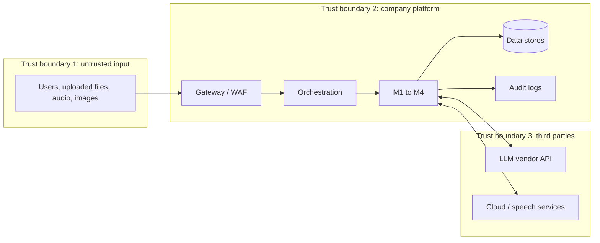

# Assignment 1: Solution

| | |
|---|---|
| Version | 1.0 (23 November 2026) |
| Author | Hatix Ntsoa, acting as CTO / Head of Cyber Risk |
| Inputs | [problem.md](problem.md), [scenario](../../docs/scenario.md), Regulation (EU) 2024/1689 as amended by Regulation (EU) 2026/1744 |

## 1. Executive summary

- SmartAdvisor AI **is an AI system** within Art. 3(1), module by module. The AI Act applies.
- The company is the **provider** (Art. 3(3)). Customers are **deployers** (Art. 3(4)). The LLM vendor is a **general-purpose AI model provider** upstream.
- If the company is established outside the Union, it is still in scope (Art. 2(1)(a)) and will need an **EU authorised representative** for any high-risk module (Art. 22).
- Autonomy is **assistive to conditionally automated**. Nothing in the design is fully autonomous, which is a deliberate lever for human oversight later.
- Decision requested: approve the role qualification and open Assignment 2 (classification).

## 2. The legal definition (Art. 3(1))

> A machine-based system that is designed to operate with varying levels of autonomy, that may exhibit adaptiveness after deployment, and that, for explicit or implicit objectives, infers, from the input it receives, how to generate outputs such as predictions, content, recommendations or decisions that can influence physical or virtual environments.

### 2.1 Decomposition into testable elements

| # | Element | Test applied | Note |
|---|---|---|---|
| E1 | Machine-based | Runs on hardware and software | Always true for software products |
| E2 | Varying levels of autonomy | Some independence from human involvement in how outputs are produced | Assessed on the scale in section 4.2 |
| E3 | May exhibit adaptiveness after deployment | Capability, **not a requirement** | Present if models are retrained or fine-tuned on live data |
| E4 | Explicit or implicit objectives | System has a goal, stated or emergent | E.g. maximise answer relevance |
| E5 | **Infers** from input how to generate output | The discriminating element: learned inference, not only fixed rules | Separates AI from classical rule-based software |
| E6 | Outputs: predictions, content, recommendations, decisions | Output type | All four appear across the modules |
| E7 | Can influence physical or virtual environments | Output has effect on people, decisions or systems | Diagnostics and recommendations clearly do |

E5 is the critical test. The Commission's guidelines on the definition (February 2025) confirm that systems relying only on rules defined by natural persons, or on basic statistics and data processing, fall outside the definition.

## 3. Qualification of SmartAdvisor AI

| Module | E1 | E2 | E3 | E4 | E5 | E6 | E7 | Verdict |
|---|---|---|---|---|---|---|---|---|
| M1 Conversational agent | Yes | Yes | Possible (feedback tuning) | Yes | **Yes**: LLM generates language | Content | Yes | **AI system** |
| M2 Image analysis | Yes | Yes | Possible (retraining) | Yes | **Yes**: learned feature extraction and classification | Predictions | Yes | **AI system** |
| M3 Document analysis | Yes | Yes | Possible | Yes | **Yes**: NLP and LLM extraction, beyond fixed OCR templates | Content, predictions | Yes | **AI system** |
| M4 Recommendation engine | Yes | Yes | Likely (learns from histories) | Yes | **Yes**: learned ranking and scoring | Recommendations | Yes | **AI system** |

**Watch-point.** A deterministic part of M3 (for example a regular-expression invoice parser with no learning) would fall outside the definition. The conclusion is therefore valid for the **learned** components only; the inventory must record which components are learned and which are rules (section 6).

## 4. Technical decomposition

### 4.1 Inputs, outputs and techniques

| Module | Input data | Output | Technique (ML / NLP / CV) | Model origin (assumed) |
|---|---|---|---|---|
| M1 | Text; audio (speech) | Text and synthetic voice answers | Speech-to-text, LLM (transformer), text-to-speech | Third-party GPAI model via API |
| M2 | Images | Interpretations, diagnostic suggestions with confidence | CNN / vision transformer; classification, detection, segmentation | In-house trained or fine-tuned |
| M3 | PDFs (contracts, invoices) | Structured fields, clause flags, anomalies | OCR, named-entity recognition, LLM extraction | Mixed: OCR in-house, LLM third-party |
| M4 | Histories and profiles | Ranked recommendations | Supervised learning to rank, collaborative filtering | In-house |

### 4.2 Autonomy scale used

| Level | Description | Typical control |
|---|---|---|
| A1 | **Assistive**: a human always decides | Review by default |
| A2 | **Advisory**: system proposes, human may accept or ignore | Acceptance logging |
| A3 | **Conditional automation**: acts unless a human intervenes | Intervention and stop mechanisms |
| A4 | **Full automation** within bounds | Not permitted in this design |

| Module | Level | Rationale |
|---|---|---|
| M1 | A2 (A3 if the agent is allowed to trigger actions) | Tool use must be gated |
| M2 | A1-A2 | Output is a suggestion to a professional or user |
| M3 | A2-A3 | Extracted data may flow into downstream systems automatically |
| M4 | A1-A2 | Output assists a human decision |

**Design decision D-1:** no module operates at A4; any A3 pathway requires an explicit stop mechanism and an owner.

## 5. Scope and roles

### 5.1 Material and territorial scope (Art. 2)

| Provision | Application |
|---|---|
| Art. 2(1)(a): providers placing systems on the Union market, wherever established | **Applies** (assumption A-01) |
| Art. 2(1)(b): deployers established in the Union | Applies to EU customers |
| Art. 2(1)(c): third-country providers or deployers where the **output is used in the Union** | Applies as a backstop |
| Art. 2(3): military, defence, national security | Not applicable |
| Art. 2(6)-(8): scientific research; pre-market R&D | Applies only during development; **not** to real-world testing |
| Art. 2(10): deployers in personal, non-professional use | B2C individuals escape deployer duties, but the provider's duties remain |
| Art. 2(12): free and open-source | Does not shield high-risk systems, Art. 5 practices or Art. 50 duties |

### 5.2 Role qualification

| Actor | Role | Consequence |
|---|---|---|
| Company | Provider (Art. 3(3)) | Carries the full provider obligations if any module is high-risk (Art. 16) |
| Business customers | Deployers (Art. 3(4)) | Art. 26 duties; Art. 27 fundamental-rights impact assessment where applicable |
| LLM vendor | GPAI model provider | Must give downstream providers the documentation of Art. 53(1)(b) |
| Company, if it modifies a customer's branded system, or puts its name on a third party's system | May become a provider under Art. 25 | Value-chain clause needed in contracts |

**Design decision D-2:** keep the "provider" qualification explicit in the product's governance and in contracts, and assess any white-label or resale scenario against Art. 25 before signature.

## 6. Data-flow and trust boundaries

**AI component inventory (first cut).** For each learned component: owner, purpose, model and version, training data lineage, vendor, hosting region, autonomy level, personal-data categories. This inventory is the control that every later assignment depends on.

## 7. Initial attack-surface observations (feed Assignment 2)

| Surface | Observation | Pointer |
|---|---|---|
| Untrusted documents processed by an LLM | Indirect prompt injection through contract or invoice content | OWASP LLM01 |
| Audio input | Spoofed or replayed voice; adversarial audio | MITRE ATLAS evasion |
| Image input | Adversarial perturbations; malformed files | Art. 15(5) |
| Third-party LLM and cloud | Personal and confidential data leave the platform | GDPR Chapter V; ISO 27001 5.23 |
| Training pipelines | Poisoned or unlicensed data | Art. 10; OWASP LLM04 |
| Logs | Logs may contain personal data and prompts | GDPR Art. 5(1)(c) |

## 8. AI literacy (Art. 4, as recast by the Omnibus)

Since 27 July 2026, providers and deployers must **take measures to support** AI literacy of staff and other persons operating AI systems on their behalf, taking account of their knowledge, experience and context. No specific level has to be *guaranteed*, but it remains an enforceable duty (national authorities, from 2 August 2026) and underpins the competence required for human oversight (Art. 26(2)).

| Audience | Measure | Evidence |
|---|---|---|
| Engineers and data scientists | Secure ML, data governance, AI Act obligations | Training records, completion rate |
| Oversight operators (e.g. diagnostic reviewers) | Automation bias, system limits, escalation | Competence matrix, sign-off |
| Support and sales | Intended purpose and prohibited uses | Scripted responses, quiz results |
| Customers (deployers) | Instructions for use, limits | Onboarding checklist |
| Executives | Accountability, risk appetite | Board briefing minutes |

## 9. Conclusion and hand-off

1. The AI Act applies to all four modules through the Art. 3(1) definition.
2. The company's provider status concentrates the obligations on the CTO's organisation.
3. Open points for Assignment 2: confirmation of the **intended purpose** of M2 and M4 per use case (assumptions A-03 and A-04), and confirmation of the establishment of the company (A-02).

| Open point | Owner | Needed by |
|---|---|---|
| Intended-purpose statements for M2 and M4 | Product and Legal | Start of Assignment 2 |
| Establishment and authorised representative decision | Legal | Before any high-risk placement |
| AI component inventory v1 | CTO office | Programme month 1 |
