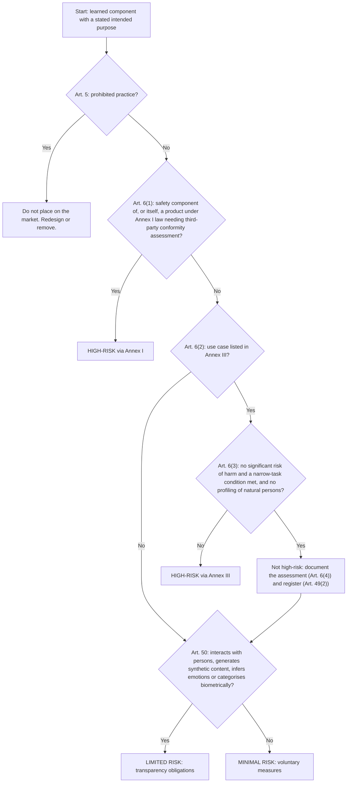

# Assignment 2: Solution

| | |
|---|---|
| Version | 1.0 (23 November 2026) |
| Author | Hatix Ntsoa, acting as CTO / Head of Cyber Risk |
| Inputs | [problem.md](problem.md), [Assignment 1](../01.scope.and.definition/solution.md), [methodology](../../docs/methodology.md) |

## 1. Executive summary

| Module | Tier | Anchor | Dependency |
|---|---|---|---|
| M1 Conversational agent | **Limited risk** (transparency) | Art. 50(1), 50(2) | Becomes a prohibited-practice problem if it infers emotions at work or in education |
| M2 Image analysis | **High-risk** if diagnostic | Art. 6(1), Annex I (MDR) | Intended purpose; software class under MDR |
| M3 Document analysis | **Minimal**, high-risk in specific uses | Annex III 4(a), 5(b), 5(c) | Use for hiring, credit scoring, insurance |
| M4 Recommendation engine | **High-risk** in Annex III domains; otherwise limited or minimal | Art. 6(2), Annex III 3, 4, 5 | Intended purpose; profiling rule in Art. 6(3) |

- **No module is prohibited by design.**
- The perimeter of high-risk obligations is a **design choice** controlled by intended purpose, ring-fencing and contracts; it must be documented, not assumed.
- 22 risks are assessed. 6 are critical before treatment. After treatment, no critical risk remains; one high residual (diagnostic false negatives) requires **board acceptance**.
- First dates that bite: **Art. 50 (already applicable)**, then **2 December 2027** (Annex III) and **2 August 2028** (Annex I).

## 2. The four tiers and their anchors

| Tier | Legal anchor | Consequence |
|---|---|---|
| **Unacceptable** | Art. 5 (Chapter II) | Prohibited; fines up to EUR 35M or 7% of worldwide turnover (Art. 99(3)) |
| **High** | Art. 6 with Annex I (regulated products) and Annex III (use cases) | Full requirements of Arts. 8-15 and provider obligations of Arts. 16-27, conformity assessment, CE marking, registration |
| **Limited** | Art. 50 | Transparency duties: disclosure of AI interaction, marking of synthetic content, notice of emotion recognition or biometric categorisation |
| **Minimal** | Residual | No mandatory obligations; voluntary codes of conduct (Art. 95) |

General-purpose AI models carry a separate regime (Chapter V). The LLM vendor bears it; the company relies on the vendor's documentation (Art. 53(1)(b)).

## 3. Decision procedure

## 4. Screening against prohibited practices (Art. 5)

| Art. 5(1) | Practice | SmartAdvisor exposure | Verdict and control |
|---|---|---|---|
| (a) | Subliminal, manipulative or deceptive techniques materially distorting behaviour | Persuasive tuning of M1 or M4 objective functions | Not intended. Audit objective functions; UX review; no engagement-maximising loops on sensitive topics |
| (b) | Exploiting vulnerabilities (age, disability, socio-economic situation) | B2C users in vulnerable situations | Not intended. Vulnerability safeguards; age-appropriate prompts; escalate to a human |
| (c) | Social scoring | M4 aggregating behaviour across contexts | Not intended. Prohibit cross-context scoring in design rules and contracts |
| (d) | Predicting criminal offences from profiling | None | Not applicable |
| (e) | Untargeted scraping of facial images | M2 training data sourcing | Not applicable if datasets are licensed. Dataset provenance rule |
| (f) | **Emotion inference in the workplace or education** (except medical or safety reasons) | **M1 voice analysis**, B2B deployments | **Tripwire.** Disable affect inference; contractual prohibition |
| (g) | Biometric categorisation to infer sensitive attributes | M2 if it infers race, health status, orientation from faces | **Tripwire.** Technical block and test; scope M2 to non-biometric imagery |
| (h) | Real-time remote biometric identification in public spaces for law enforcement | None | Not applicable |

The Omnibus adds prohibitions on AI systems that generate non-consensual intimate content and child sexual abuse material, applicable from **2 December 2026**. A content-safety filter on any generative path (M1 and any image generation) is a required control.

**Conclusion:** no prohibited practice by design. Two tripwires (f, g) and two behavioural risks (a, b) are managed through requirements, tests and contract terms (risks R-12 and R-13).

## 5. Module-by-module classification

### 5.1 The principle that drives everything: intended purpose

Classification follows the **intended purpose** (Art. 3(12)) declared by the provider in the instructions for use, technical documentation and promotional material, and the **reasonably foreseeable misuse** that the risk management system must consider (Art. 9(2)(b)). The same model can be minimal in one deployment and high-risk in another.

### 5.2 Matrix

| Module | Use case examples | Annex route | Tier | Justification (impact on users) |
|---|---|---|---|---|
| **M1** | General Q&A; support; guidance | None; Art. 50 | **Limited** | Persons interact with an AI and receive synthetic voice. Impact is informational. Disclosure and voice marking required |
| **M1 (variant)** | Voice emotion inference at work or in schools | Art. 5(1)(f) | **Prohibited** | Not allowed (medical or safety reasons excepted) |
| **M2 (diagnostic)** | Medical image interpretation supporting a clinician or patient | **Annex I Section A**: MDR (EU) 2017/745 software; high-risk under Art. 6(1) when third-party conformity assessment is required (typically MDR class IIa and above) | **High** | Output can influence health decisions. Maximum requirements |
| **M2 (non-medical)** | Interpreting a situation from an image with no medical purpose | Depends on the domain, for example Annex III 2 (critical infrastructure safety) | **Case-by-case; otherwise limited or minimal** | Needs a domain check; no automatic classification |
| **M3 (standard)** | Contract and invoice data extraction for business processes | None | **Minimal** | Low impact on individuals. Voluntary good practice |
| **M3 (credit)** | Evaluating creditworthiness or credit scores of natural persons | **Annex III 5(b)** | **High** | Access to essential private services |
| **M3 (employment)** | Screening CVs, evaluating candidates | **Annex III 4(a)** | **High** | Access to employment |
| **M3 (insurance)** | Risk assessment and pricing in life and health insurance | **Annex III 5(c)** | **High** | Essential services |
| **M4 (general)** | Content, product, productivity recommendations | None | **Minimal / limited** | Assists a choice with low consequence |
| **M4 (sensitive)** | Education access or grading; recruitment and promotion; essential services, benefits, credit, emergency triage | **Annex III 3, 4, 5** | **High** | Output can influence important life decisions |

### 5.3 The Art. 6(3) derogation and the profiling rule

An Annex III system is **not** high-risk if it does not pose a significant risk of harm to health, safety or fundamental rights, for example because it performs a narrow procedural task, improves a previously completed human activity, detects decision patterns without replacing human assessment, or performs a preparatory task. **However, a system that performs profiling of natural persons is always high-risk.** M4 builds user profiles, so for M4 the derogation will rarely be available.

A provider relying on the derogation must **document the assessment before placing the system on the market** (Art. 6(4)) and **register** it (Art. 49(2)); the Omnibus kept that registration duty.

### 5.4 System-level view and design decisions

SmartAdvisor AI is one product, but obligations attach to **systems with an intended purpose**. Two options exist:

| Option | Description | Pros | Cons |
|---|---|---|---|
| **A. Ring-fence** | Split M2 and M4 into separately governed systems; restrict intended purpose by contract and technical limits (for example, M4 blocked for Annex III uses) | Shrinks the high-risk perimeter and cost | Needs strong controls on misuse; classification must be documented and defensible |
| **B. Accept high-risk for the sensitive modules** | Build full Chapter III compliance for M2 and M4 | Opens regulated markets; lower reclassification risk | Highest cost and effort |

**Decision D-3 (recommended):** Option A for M3 and M4 generic use; **Option B** for M2 diagnostic and for any M4 / M3 use case in Annex III that is commercially strategic. Use-case restrictions are enforced by **technical gating** (feature flags per tenant), **contract clauses**, and **telemetry-based detection of drift in use** (risk R-19).

**Decision D-4:** emotion inference and biometric categorisation are **removed from the product backlog** (risks R-12 and R-13).

## 6. Penalty exposure (Art. 99)

| Infringement | Maximum fine (undertaking) | Relevance |
|---|---|---|
| Art. 5 prohibited practices | EUR 35M or **7%** of worldwide annual turnover, whichever is higher | Emotion inference; manipulation |
| Provider obligations (Art. 16), authorised representative (Art. 22), deployer obligations (Art. 26), **transparency (Art. 50)** | EUR 15M or **3%** | Any high-risk gap; chatbot disclosure |
| Incorrect, incomplete or misleading information to authorities | EUR 7.5M or **1%** | Misleading conformity information |

For SMEs and start-ups, Art. 99(6) applies the **lower** of the two amounts. The exposure that matters most commercially is rarely the fine itself but **market withdrawal and customer loss**, which is why misclassification (R-01) is rated critical.

## 7. Risk register summary

Full register with treatment and residual scoring: [artifacts/risk.register.md](artifacts/risk.register.md).

| Rating | Inherent | Residual |
|---|---|---|
| Critical (15-25) | 6 | **0** |
| High (10-14) | 15 | 1 |
| Medium (5-9) | 1 | 16 |
| Low (1-4) | 0 | 5 |

**Top five inherent risks:** R-02 prompt injection, R-03 data disclosure through third-party LLM, R-01 misclassification, R-05 biased recommendations, R-04 diagnostic false negatives and over-reliance.

## 8. Conclusion and hand-off

1. No prohibited practice by design; four risks (R-12, R-13 and the tripwires) are controlled by redesign and contract.
2. M2 (diagnostic) and sensitive-use M4 and M3 are **high-risk**; M1 is **limited**; the rest is minimal.
3. Assignment 3 takes the **high-risk perimeter** (M2 diagnostic and M4 Annex III) and designs the requirements of Chapter III around it.

| Decision | Owner | Status |
|---|---|---|
| D-3 ring-fencing strategy | CTO, Legal, Product | Proposed |
| D-4 removal of emotion inference and biometric categorisation | Product | Proposed |
| Board acceptance of residual R-04 | Board | Required before go-live of M2 |
