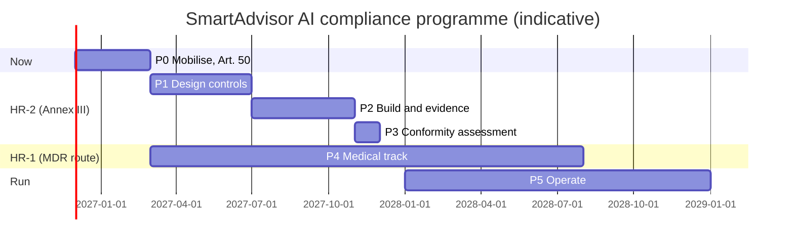

# Implementation roadmap and RACI

| | |
|---|---|
| Version | 1.0 (23 November 2026) |
| Basis | Legal calendar in [regulatory.timeline.md](../../../docs/regulatory.timeline.md) |
| Status | Indicative; **re-baseline** on any change of dates, harmonised standards or notified-body availability |

## 1. Phases

| Phase | Window | Objective | Key deliverables | Exit gate |
|---|---|---|---|---|
| **P0 Mobilise and baseline** | Dec 2026 - Feb 2027 | Govern, inventory, decide | Programme charter; AI component inventory v1; classification file and decisions D-3, D-4; gap assessment against [matrix](compliance.matrix.md); **Art. 50 disclosure and voice marking in production**; AI literacy plan | Steering committee approves scope and budget |
| **P1 Design the controls** | Mar - Jun 2027 | Design once, shared | QMS integrated with ISMS and AIMS; risk management procedure; data governance standard; log schema; oversight policy; test plan; vendor contracts | Design review passed |
| **P2 Build and evidence** | Jul - Oct 2027 | Implement and prove | Compliance plane (log, registry, monitoring); oversight console; explanation service; data cards and bias reports; red-team and robustness reports; Annex IV technical file; deployer FRIA pack | Internal audit passed; technical file complete |
| **P3 Conformity (HR-2)** | Nov 2027 | Place M4 and Annex III uses on the market | Annex VI internal-control assessment; EU declaration; CE marking; EU database registration | Complete **before 2 Dec 2027** |
| **P4 Medical track (HR-1)** | 2027 - Aug 2028 | Conformity for M2 through MDR | Clinical evaluation and validation; MDR technical file including AI Act requirements; notified-body engagement; post-market plan | Certificate **before 2 Aug 2028** |
| **P5 Operate and improve** | From go-live | Stay compliant | Post-market monitoring; incident exercises; internal audits; management review; change gate | Annual review cycle |

## 2. Critical path and dependencies

| Dependency | Impact | Mitigation |
|---|---|---|
| Intended-purpose decisions (D-3, D-4) | Sets the high-risk perimeter and the dates | Decide in P0 |
| Clinical validation data for M2 | Longest lead time | Start protocol design in P0 |
| LLM vendor terms (zero retention, EU region, change notice) | Blocks R-03 treatment | Shortlist and negotiate in P0-P1 |
| Harmonised standards and guidance | Interpretation risk | Track; use ISO/IEC 42001 and 27001 as interim operating model |
| Notified-body capacity | HR-1 date risk | Engage early; keep a buffer |
| National sandbox availability | Optional learning route | Check national position |

## 3. Budget drivers (to be sized in the P0 pilot)

| Driver | Nature |
|---|---|
| Compliance plane engineering | One-off build and run |
| Storage and monitoring | Recurring, volume-dependent |
| Oversight staffing | Recurring, depends on review volumes |
| Clinical validation and notified body | One-off, long lead |
| Training and certification | Recurring, small |
| External audit and red team | Recurring |
| Legal and authorised representative | Recurring, small |

## 4. RACI

R = Responsible, A = Accountable, C = Consulted, I = Informed.

| Activity | Board | CTO | Compliance | DPO | Head of ML | CISO | Medical lead | Product / Legal |
|---|---|---|---|---|---|---|---|---|
| Risk appetite and R-04 acceptance | **A** | R | C | C | C | C | C | I |
| Classification and intended purpose | I | **A** | R | C | C | C | C | R |
| Risk management system (Art. 9) | I | **A** | R | C | R | R | C | C |
| Data governance (Art. 10) | I | C | C | R | **A/R** | C | C | I |
| Technical file (Art. 11) | I | **A** | R | C | R | R | C | C |
| Logging (Art. 12) | I | C | C | C | C | **A/R** | I | I |
| Instructions for use (Art. 13) | I | C | R | I | C | I | C | **A/R** |
| Human oversight (Art. 14) | I | **A** | C | I | R | C | R | C |
| Robustness and cybersecurity (Art. 15) | I | C | C | I | R | **A/R** | I | I |
| QMS (Art. 17) and audits | I | **A** | R | C | C | R | I | C |
| Conformity, declaration, registration | I | **A** | R | C | C | C | C | R |
| Art. 50 transparency | I | C | C | I | C | I | I | **A/R** |
| Post-market monitoring (Art. 72) | I | **A** | C | C | R | R | R | I |
| Incident reporting (Art. 73) | I | C | R | R | C | **A/R** | C | R |
| Vendor management | I | **A** | C | R | C | R | I | R |
| AI literacy (Art. 4) | I | C | **A/R** | I | C | C | C | C |

## 5. Programme KPIs

| KPI | Target |
|---|---|
| Matrix controls evidenced | 100% before each conformity date |
| Open critical risks | 0 at every release gate |
| Art. 50 disclosure coverage | 100% of sessions |
| Incident clock compliance | 100% in exercises |
| Oversight operators certified before access | 100% |
| Schedule variance on critical path | Escalate beyond one month |
