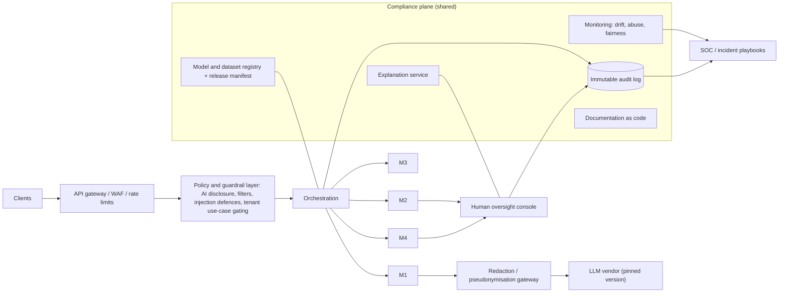

# Assignment 3: Solution

| | |
|---|---|
| Version | 1.0 (23 November 2026) |
| Author | Hatix Ntsoa, acting as CTO / Head of Cyber Risk |
| Inputs | [problem.md](problem.md), [Assignment 2](../02.risk.classification/solution.md), [risk register](../02.risk.classification/artifacts/risk.register.md) |
| Strategy | **Compliance by design**, using one management system that serves both the AI Act and ISO/IEC 27001 / 42001 |

## 1. Executive summary

- **Perimeter:** HR-1 = M2 diagnostic (Annex I route via MDR; applies **2 Aug 2028**). HR-2 = M4 in Annex III domains and any strategic M3 use case in Annex III (applies **2 Dec 2027**).
- **Build once:** one set of controls (risk system, data governance, logging, oversight, robustness) is implemented as a shared **compliance plane** across all modules, so that M1 and M3 benefit too.
- **Conformity routes:** HR-2 by **internal control** (Annex VI, Art. 43(2)); HR-1 through the **MDR notified-body procedure**, with AI Act requirements assessed inside it.
- **Art. 50 is already applicable** and is the first delivery, ahead of the high-risk work.
- **Asks to the board:** fund the compliance plane, approve the use-case restrictions of Assignment 2, accept residual R-04 conditionally.

## 2. Part A: Requirements, designed and mapped

The full mapping with evidence, owners and KPIs is in the [compliance matrix](artifacts/compliance.matrix.md). Concrete formats are in the [technical specifications](artifacts/technical.specifications.md).

### 2.1 Risk management system (Art. 9)

**Requirement.** A continuous, iterative process across the lifecycle: identify and analyse known and reasonably foreseeable risks to health, safety and fundamental rights, including those from reasonably foreseeable misuse; evaluate risks that emerge from post-market data; adopt targeted measures; test the system; consider impact on persons under 18 and other vulnerable groups.

**Implementation.**

- Maintain the [risk register](../02.risk.classification/artifacts/risk.register.md) as the single source, reviewed at each release, incident and quarterly.
- Frame risks with the **ISO/IEC 27005 / 23894** method and the **NIST AI RMF** functions; run the **ISO/IEC 42001** AI risk assessment (6.1.2, 8.2) and system impact assessment (6.1.4, 8.4).
- Add a **foreseeable-misuse analysis** per use case; every identified misuse has an owner and a control.
- Define testing against **pre-defined metrics and thresholds** (Art. 9(6)-(8)), recorded in the test plan.

### 2.2 Data and data governance (Art. 10)

**Requirement.** Training, validation and testing data must be relevant, sufficiently representative, as free of errors as possible and complete for the intended purpose, with documented design choices, provenance, preparation, assumptions, bias examination and mitigation, and gap analysis.

**Implementation.**

- **Versioned datasets** with content hashes and lineage (data version control), immutable once used in a release.
- **Data cards** per dataset: source, licence, collection method, consent or legal basis, known limits.
- **Validation pipeline:** schema and quality checks, duplicate and leakage detection, label-quality audits, representativeness checks against the intended population.
- **Bias examination:** metrics per subgroup relevant to the intended purpose; proxy-variable analysis; documented mitigation. Processing special-category data strictly to detect and correct bias is allowed only under the Art. 10(5) conditions (strict necessity, safeguards, deletion after use).
- **Poisoning defences:** signed artefacts, provenance checks, anomaly scans, isolated training environment.

### 2.3 Technical documentation (Art. 11, Annex IV)

**Requirement.** Drawn up **before** placing on the market and kept up to date; it must show compliance and give authorities what they need to assess it.

**Implementation.**

- **Documentation as code:** Annex IV sections kept in the repository, built in the CI pipeline, with a **completeness gate** that fails the release if an evidence link is missing.
- Auto-generated sections: model cards, dataset cards, architecture diagrams, test reports, release manifest.
- Traceability: **requirement, control, test, evidence, release**, queryable.
- SMEs may use the simplified documentation form the Commission provides; the Omnibus extended simplifications to small mid-caps.

### 2.4 Record-keeping (Art. 12)

**Requirement.** Automatic recording of events over the lifetime, enabling identification of risk situations and substantial modifications, supporting post-market monitoring and operation monitoring.

**Implementation.** Structured, append-only audit events per inference (identifiers, model and prompt version, input hash, output hash, confidence, human decision, latency, policy results), time-synchronised, stored immutably, with **personal data minimised** (hashes and references, not raw content, by default) and retention of at least six months (Art. 19(1)) or longer where sector law requires. See the [log schema](artifacts/technical.specifications.md#1-audit-log-event-schema).

### 2.5 Transparency and information to deployers (Art. 13)

**Requirement.** Systems must be sufficiently transparent for deployers to interpret and use the output appropriately, with **instructions for use**: provider identity, intended purpose, accuracy, robustness and cybersecurity levels, known circumstances of risk, performance for specific groups, input data specifications, human-oversight measures, expected lifetime and maintenance, and how to interpret and log outputs.

**Implementation.** A versioned **Instructions for Use** document generated from the release manifest and test reports; in-product limits displayed next to each output (confidence, scope, "not a substitute for professional judgement"); a **user notice** layer for Art. 50 ("This response was generated by AI", synthetic voice marking).

### 2.6 Human oversight (Art. 14)

**Requirement.** Designed so that natural persons can effectively oversee the system: understand capacities and limits, stay aware of **automation bias**, interpret output correctly, **decide not to use or override** the output, and **interrupt** the system through a stop control.

**Implementation.**

- **Risk-tiered routing policy:** low-confidence or out-of-distribution results are never shown as findings; M2 diagnostic outputs always require qualified review before reaching a patient; M4 outputs in Annex III contexts require human validation before affecting a person.
- **Oversight console:** shows the output, confidence, evidence (for example saliency), model version, and offers accept, modify, reject and escalate; rejections are logged and feed monitoring.
- **Stop control:** a tenant-level and global kill switch with tested recovery.
- **Competence:** oversight operators are trained and certified (Arts. 4, 26(2)).
- See the [oversight policy](artifacts/technical.specifications.md#2-human-oversight-routing-policy).

### 2.7 Accuracy, robustness and cybersecurity (Art. 15)

**Requirement.** Appropriate levels of accuracy (declared in the instructions for use), **resilience to errors and inconsistencies**, **feedback-loop controls** for systems that keep learning, and resilience against unauthorised third parties exploiting vulnerabilities, including **data poisoning, model poisoning, adversarial examples and confidentiality attacks**.

**Implementation.**

| Layer | Controls |
|---|---|
| Accuracy | Declared metrics on held-out and subgroup data; acceptance thresholds in the test plan |
| Robustness | Out-of-distribution detection; input validation; fallbacks and safe failure; redundancy |
| Adversarial | Evasion testing for images and audio; prompt-injection test suites; red teaming each release |
| Supply chain | Signed models and datasets; pinned dependencies; AI bill of materials; vendor change notices |
| Platform | **TLS 1.3** in transit; **AES-256** at rest with envelope encryption and managed keys; network segmentation; secrets vault; phishing-resistant MFA and privileged access management |
| Monitoring | Drift, anomaly and abuse detection feeding the SOC |

### 2.8 Provider obligations and quality management (Arts. 16-22, 25)

- **Quality management system (Art. 17):** policies and procedures for compliance strategy, design and development, testing, data management, risk management, post-market monitoring, incident reporting, communication with authorities, record-keeping, resource management and accountability. It is **integrated with the ISMS (ISO/IEC 27001) and AIMS (ISO/IEC 42001)** to avoid parallel systems.
- **Documentation and logs retained** for ten years (Art. 18) and logs under provider control for at least six months (Art. 19).
- **Corrective actions and duty to inform** (Art. 20) and **cooperation with authorities** (Art. 21).
- **Authorised representative** in the Union if the company is outside it (Art. 22).
- **Value chain (Art. 25):** contracts with the LLM vendor and any integrators allocate responsibilities and secure the documentation the company needs.

### 2.9 Conformity assessment, declaration, marking, registration (Arts. 43, 47-49)

| Step | HR-2 (M4 Annex III) | HR-1 (M2 via MDR) |
|---|---|---|
| Conformity assessment | **Internal control** (Annex VI) for Annex III points 2 to 8 | **Notified body** under MDR, covering AI Act requirements |
| EU declaration of conformity | Art. 47 | Art. 47 with MDR declaration |
| CE marking | Art. 48 | Single marking under MDR |
| Registration | EU database, Art. 49 | EU database, Art. 49 |
| Re-assessment | On **substantial modification** | On substantial modification (MDR rules also apply) |

A **change-control gate** classifies every model update as substantial or not against pre-agreed criteria.

### 2.10 After the market: monitoring and incidents (Arts. 72-73)

- **Post-market monitoring plan (Art. 72):** drift, performance, overrides, complaints and incident data analysed on a schedule, feeding the risk register.
- **Serious incident reporting (Art. 73):** report to the market surveillance authority **no later than 15 days** after awareness, **2 days** for widespread infringement or critical infrastructure disruption, **10 days** in the event of death; initial incomplete reports are allowed. The playbook runs these clocks in parallel with GDPR (72 hours) and, where applicable, NIS2 notification.

### 2.11 What changes for deployers (Arts. 26-27, 86)

The provider must **enable** the customer to comply: instructions for use, logs available to the deployer (Art. 26(6) keeps them at least six months), oversight tooling, and a **fundamental-rights impact assessment (FRIA) pack** for deployers that must do one under Art. 27 (public bodies, private entities providing public services, and deployers of Annex III 5(b) and 5(c) systems). Affected persons have a **right to explanation** of decisions taken by a deployer on the basis of a high-risk system's output where those decisions have legal or similarly significant effects (Art. 86). The explanation service in section 3.3 is the technical counterpart.

## 3. Part B: Technical and organisational implications

### 3.1 Target architecture

Key points:

1. **Policy layer** in front of the models enforces Art. 50 disclosure, input and output filters and tenant-level restriction of use cases (the technical half of the ring-fencing decision).
2. **Redaction gateway** removes or pseudonymises personal data before calls to third-party LLMs.
3. **Compliance plane** is shared: one audit log, one registry, one monitoring stack for all modules.
4. **Separation of environments** for training, test and production, with privileged access through a bastion and just-in-time elevation.
5. **Vendor abstraction layer** allows switching LLM vendors and pinning versions.

### 3.2 Traceability and versioning

Every production decision is traceable to a **release manifest**: code commit, model version and weights hash, prompt and configuration version, dataset versions, policy version, evaluation report, approver. Changes follow a controlled path (propose, test, assess "substantial modification", approve, deploy, monitor). See the [release manifest](artifacts/technical.specifications.md#3-release-manifest).

### 3.3 Explainability

| Module | Technique | Limits |
|---|---|---|
| M4 | Feature attributions and **reason codes** per recommendation | Attributions are approximations; validate stability |
| M2 | Saliency maps and similar-case retrieval, shown to the reviewer | Saliency can mislead; never presented as proof |
| M1 / M3 | Retrieval citations to source passages and a short rationale | Do not expose raw reasoning traces as explanations; log them as evidence only |

The goal is an explanation **adequate for the decision and the audience** (deployer, reviewer, affected person), not a full model internals report.

### 3.4 Trade-offs: cost, performance, user experience

| Measure | Cost drivers | Performance | User experience | Mitigation |
|---|---|---|---|---|
| Structured audit logging | Storage, retention, tooling, privacy review | Small added latency if asynchronous | Invisible | Asynchronous pipeline; hash-based minimisation |
| Immutable storage | Storage tier and retrieval cost | None on the hot path | Invisible | Tiered retention |
| Redaction gateway | Engineering and per-request compute | Added latency; some accuracy loss on redacted fields | Possible context loss | Entity-aware redaction; reversible tokens |
| Human oversight | Staff time; reviewer training | Slower for reviewed cases | Delay on diagnostics and sensitive recommendations | Risk-tiered routing; only review what the policy requires |
| Explainability | Compute for attributions; UI work | Added latency for explanation on demand | More information, if designed well | Compute on demand; cache |
| AI disclosure and voice marking | Low | Negligible | Slight friction at first use | Concise, consistent wording |
| Adversarial testing and red team | Recurring effort and tooling | None in production | None | Automate suites in CI |
| Conformity assessment and audits (Art. 43) | External and internal audit cost; notified-body fees for HR-1 | None | None | Early gap assessment; reuse ISO evidence |
| Versioning and dataset control | Registry and storage | None | None | Automate through CI/CD |

Figures depend on volumes and vendors and should be **benchmarked in a pilot** before budget approval; the matrix above identifies where to measure.

### 3.5 Organisation

| Role | Responsibility |
|---|---|
| Board | Risk appetite; acceptance of residual R-04; funding |
| CTO / Head of Cyber Risk | Programme owner; architecture; control effectiveness |
| Head of Compliance | AI Act mapping; technical file; liaison with authorities |
| DPO | GDPR, DPIA, data transfers |
| Head of ML | Data governance, evaluation, drift, fairness |
| CISO / SOC | Security controls, monitoring, incident handling |
| Medical or domain lead | Clinical validation; oversight competence |
| Product / Legal | Intended purpose; contracts; use-case restrictions |

The full RACI is in the [roadmap](artifacts/implementation.roadmap.md).

### 3.6 Regulatory sandbox

The company should engage with a national **AI regulatory sandbox** (Art. 57) to test M2 and M4 with supervisory feedback before full deployment. The Omnibus moved the deadline for Member States to have sandboxes in place, so availability depends on the country: check the national position before relying on it.

## 4. Conclusion

1. The high-risk perimeter is limited by design to M2 diagnostic and Annex III uses of M4 and M3, and **every one of the Arts. 9-15 requirements has a concrete control, evidence and owner**.
2. One **compliance plane** and one integrated management system keep cost and complexity proportionate.
3. The legal calendar gives time, but **Art. 50 is already live** and the long-lead items (clinical validation, data governance, notified body) start now.
4. Residual risk after treatment is within appetite except **R-04**, which is handed to the board with explicit conditions.

**Next step:** execute the [roadmap](artifacts/implementation.roadmap.md); re-baseline on any change to the legal calendar or harmonised standards.
