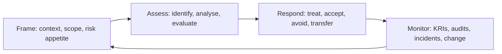

# Risk methodology and framework crosswalk

## 1. Two lenses, both required

| Lens | Question | Source | Harm measured on |
|---|---|---|---|
| **Organisational cyber risk** | What could damage our assets, services, finances or reputation? | ISO/IEC 27005:2022, ISO 31000, NIST SP 800-39 | The organisation |
| **AI Act risk** | What could this system do to people? | AI Act Art. 3(2): combination of the probability of harm and its severity; Art. 9 | Health, safety and fundamental rights of persons |

A classic ISO 27005 register misses harm to affected persons; a pure AI Act analysis misses attacks on the platform. The register in Assignment 2 scores **both** in a single impact scale.

## 2. Process

Aligned with ISO 31000 and NIST SP 800-39 (Frame, Assess, Respond, Monitor) and with the NIST AI RMF functions (Govern, Map, Measure, Manage).

| Step | Output in this repository |
|---|---|
| Frame | [scenario.md](scenario.md), roles, assumptions, appetite (section 5) |
| Assess | Assignment 1 (inventory and decomposition), Assignment 2 (classification and register) |
| Respond | Assignment 3 (controls, matrix, specifications) |
| Monitor | KPIs/KRIs in the matrix, post-market monitoring (Art. 72), incident clocks (Art. 73) |

## 3. Scales

**Likelihood (12-month horizon)**

| Level | Label | Guide |
|---|---|---|
| 1 | Rare | Not expected |
| 2 | Unlikely | Could occur once in several years |
| 3 | Possible | Could occur within the horizon |
| 4 | Likely | Expected to occur at least once |
| 5 | Almost certain | Recurring or already observed in the wild |

**Impact (highest applicable dimension)**

| Level | Label | Persons | Compliance | Business |
|---|---|---|---|---|
| 1 | Negligible | None | Observation | Minor |
| 2 | Minor | Inconvenience | Minor finding | Limited cost |
| 3 | Moderate | Reversible harm to some users | Formal finding; remediation order | Customer escalation |
| 4 | Major | Serious or discriminatory harm | Fine up to EUR 15M / 3% tier; market restriction | Loss of key customer |
| 5 | Severe | Harm to health or safety; rights violation at scale | Fine up to EUR 35M / 7% tier; withdrawal | Existential |

**Rating = Likelihood x Impact**

| Score | Band | Required action |
|---|---|---|
| 1-4 | Low | Accept and monitor |
| 5-9 | Medium | Treat within the programme; owner accountable |
| 10-14 | High | Treatment plan and executive sponsor |
| 15-25 | Critical | Immediate treatment; no go-live without compensating controls |

## 4. Treatment options

Modify (apply controls), Avoid (remove the feature or the use case), Share (insurance, contract), Retain (accept formally, with owner and review date), following ISO/IEC 27005:2022.

## 5. Risk appetite (assumed for the case)

- **Zero tolerance** for any practice prohibited by Art. 5.
- No residual risk above **Medium** without written **board acceptance**.
- No go-live of a high-risk module without a complete Annex IV technical file and a passed internal audit.
- Harm to health or safety is never accepted by the business alone: it needs clinical or domain-expert sign-off.

## 6. Crosswalk: AI Act, ISO/IEC 42001, ISO/IEC 27001:2022, NIST AI RMF

| AI Act | ISO/IEC 42001:2023 | ISO/IEC 27001:2022 Annex A | NIST AI RMF |
|---|---|---|---|
| Art. 9 Risk management system | 6.1.2-6.1.4, 8.2-8.4; A.5 | 5.1, ISO 27005 process | GOVERN, MAP, MANAGE |
| Art. 10 Data governance | A.7 (data for AI systems) | 5.34 (privacy and PII), 8.10-8.12 | MAP, MEASURE |
| Art. 11 / Annex IV Technical documentation | 7.5 (documented information); A.6.2.7 | 5.37 (documented operating procedures) | GOVERN |
| Art. 12 Record-keeping | A.6.2.8 (event logs) | 8.15 logging, 8.16 monitoring, 8.17 clock sync | MEASURE |
| Art. 13 Transparency to deployers | A.8 (information for interested parties) | 5.37 (operating procedures), 5.1 | MAP |
| Art. 14 Human oversight | A.9 (use of AI systems), A.3 | 5.3 (segregation of duties), 6.3 | GOVERN, MANAGE |
| Art. 15 Accuracy, robustness, cybersecurity | A.6.2.4 (verification and validation) | 8.8, 8.24, 8.25, 8.28, 8.29 | MEASURE, MANAGE |
| Art. 17 Quality management system | Clauses 4-10 (AIMS as a whole) | Clauses 4-10 (ISMS) | GOVERN |
| Art. 25 / 53 Value chain | A.10 (third-party and customer relationships) | 5.19-5.23 (suppliers, cloud) | GOVERN |
| Art. 50 Transparency to users | A.8.2-A.8.5 | 5.37 (operating procedures), 5.1 | MAP |
| Art. 72 Post-market monitoring | 9.1; A.6.2.6 | 8.16 | MEASURE, MANAGE |
| Art. 73 Serious incidents | A.8.4 (incident communication) | 5.24-5.28 | MANAGE |

> ISO/IEC 42001 and ISO/IEC 27001 are **management-system standards** and not harmonised standards under the AI Act, so certification does not by itself prove AI Act conformity. They provide a credible, auditable operating model while harmonised standards are finalised.

## 7. Threat taxonomies used

OWASP Top 10 for LLM Applications (prompt injection, sensitive information disclosure, supply chain, data and model poisoning, improper output handling, excessive agency, system prompt leakage, vector and embedding weaknesses, misinformation, unbounded consumption) and MITRE ATLAS techniques for evasion, poisoning and model extraction.
