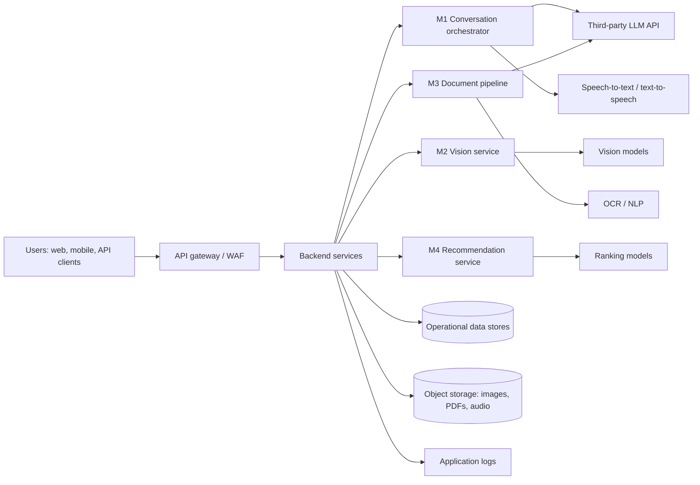

# Scenario: SmartAdvisor AI

| | |
|---|---|
| Document | Scenario and assumptions baseline |
| Version | 1.0 (23 November 2026) |
| Owner | CTO / Head of Cyber Risk |
| Status | Approved as the baseline for assignments 1 to 3 |

## 1. Context

A digital services company develops **SmartAdvisor AI**, an application sold to **businesses (B2B)** and used directly by **individuals (B2C)**. The CTO must design and deploy it in a way that is compliant with the AI Act and defensible in front of a regulator, a customer auditor and the board.

## 2. Modules

| ID | Module | Inputs | Outputs | Typical technique |
|---|---|---|---|---|
| M1 | Conversational agent | Text, voice | Text and synthetic voice answers | LLM (third-party), speech-to-text, text-to-speech |
| M2 | Image analysis | Images | Interpretations of situations, diagnostic suggestions | Computer vision (CNN / vision transformer) |
| M3 | Document analysis | PDFs: contracts, invoices | Structured data, clause and anomaly flags | OCR, NLP, LLM extraction |
| M4 | Recommendation engine | User history and profiles | Decision-support recommendations | Machine learning ranking / scoring |

## 3. Roles under the AI Act

| Actor | Role | Basis |
|---|---|---|
| The company | **Provider** of the AI system | Art. 3(3): develops the system and places it on the market under its own name |
| Business customers | **Deployers** | Art. 3(4): use the system under their authority |
| LLM vendor | **Provider of a general-purpose AI model** | Arts. 3(63), 53; upstream supplier to M1 and M3 |
| Cloud host | Processor / infrastructure supplier | GDPR Art. 28; supplier relationship under ISO/IEC 27001 |
| End users (B2C) | Affected persons | Rights under Arts. 50 and 86 and GDPR |

## 4. Reference architecture (as-is)

## 5. Assumptions (to be validated; each drives a decision later)

| ID | Assumption | Why it matters |
|---|---|---|
| A-01 | The product is offered on the EU market. | Triggers Art. 2(1)(a) regardless of where the company is established. |
| A-02 | The company may be established **outside the EU**. | An authorised representative (Art. 22) would be required for high-risk systems. |
| A-03 | M2 is marketed with a **diagnostic / health-related** intended purpose in at least one use case. | Moves M2 to the medical-device route (Art. 6(1), Annex I; MDR (EU) 2017/745). |
| A-04 | M4 may be used by customers for decisions touching education, employment, credit or insurance. | Brings M4 into Annex III unless the intended purpose is locked. |
| A-05 | LLM and cloud services come from non-EU vendors under standard contracts. | Third-party and data-transfer risk (GDPR Chapter V). |
| A-06 | The company has fewer than 250 staff. | SME fine cap rule in Art. 99(6) and proportionate documentation duties. |
| A-07 | M1 voice output is synthetic speech. | Art. 50(2) marking obligation. |

## 6. Out of scope

Customer-side obligations beyond those the provider must enable (instructions for use, logs, oversight tooling); national sector regulation beyond MDR and GDPR; commercial contract terms.
